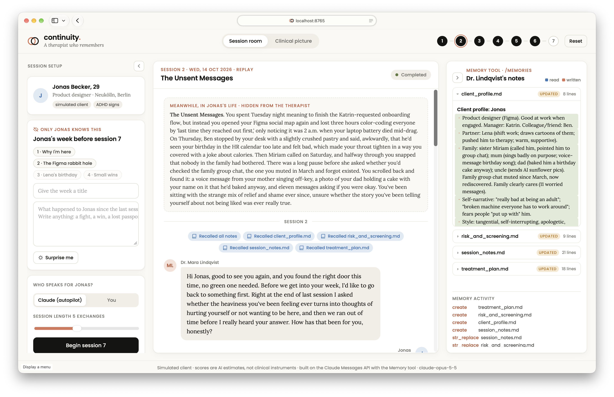
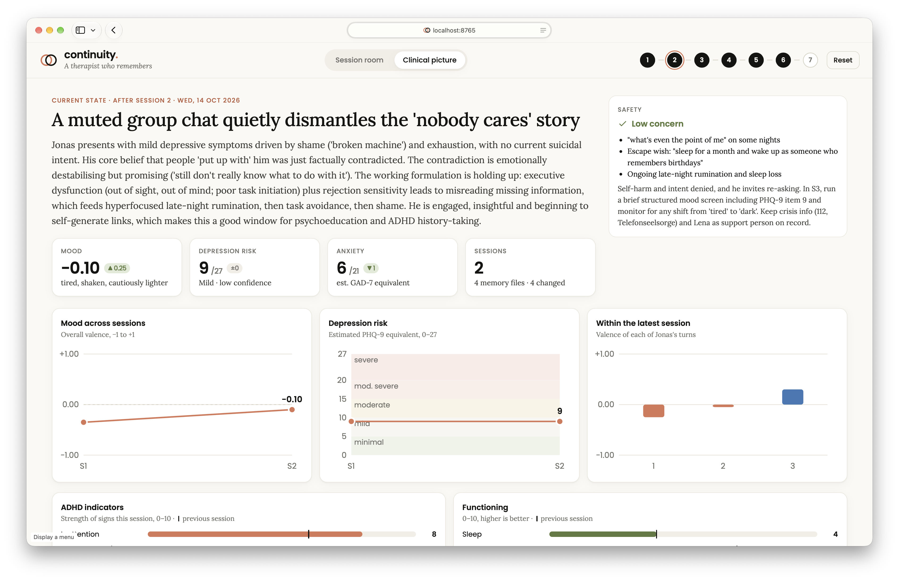

# continuity.

*A therapist who remembers.*


A two-agent demo built on the **Claude Messages API** and the **Memory tool**.

- **Dr. Mara Lindqvist** (therapist agent) has *no* recollection of earlier sessions except what she wrote into her own memory directory (`/memories`). She reads her notes before each session, uses them in conversation, and rewrites them afterwards.
- **Jonas** (patient agent) is a 29-year-old designer in Berlin with signs of undiagnosed ADHD. Between sessions, something happens in his life. Only Jonas (and the audience) knows what.
- A **supervisor** call turns each session into a structured clinical picture: mood/sentiment, estimated PHQ-9 depression risk, GAD-7 anxiety, ADHD indicators, safety, functioning, and specific intervention ideas, tracked over time.




> Simulated client. All scores are AI estimates, not clinical instruments.

## Run it

```bash
uv sync
uv run continuity            # → http://127.0.0.1:8765
```

Needs `ANTHROPIC_API_KEY` in `.env`. Optional env vars: `THERAPY_MODEL` (default `claude-opus-5-5`), `PATIENT_MODEL`, `THERAPIST_EFFORT` (default `medium`), `PATIENT_EFFORT` (default `low`).

To start the demo with history already in place (the 4-week story arc, about 12 minutes):

```bash
uv run python scripts/seed_story.py
```

**Reset** in the UI erases memory and all sessions.

## Demo script (3 minutes)

1. **Session room → Clinical picture.** Show the arc so far: mood dips at "Lena's birthday", depression risk rises, then recovers in "Small wins". Point at *How memory shaped this session*.
2. **Back to the session room.** In the memory panel on the right, open `treatment_plan.md`: this is all she knows.
3. **Pick Jonas's next week.** Use *Surprise me*, or let someone in the audience write one ("Jonas got fired", "Lena is pregnant"). Point out the label *Only Jonas knows this*.
4. **Begin the session.** Watch her *recall* files (blue), then open with a specific callback. Expand *Clinical reasoning* to show her thinking.
5. Switch Jonas to **You** to let a judge play the patient live.
6. After the session she **writes** her notes (orange). New lines are highlighted green. The assessment card appears and the clinical picture updates.

## How it works

| Piece | File | API features |
|---|---|---|
| Memory backend | `src/continuity/memory_store.py` | Client-side handler for `memory_20250818` (view / create / str_replace / insert / delete / rename), sandboxed to `data/memories` |
| Agents & orchestration | `src/continuity/engine.py` | Streaming Messages API, manual tool loop, adaptive thinking with summarized display, `effort`, prompt caching, server-side refusal fallbacks |
| Assessment schema | `src/continuity/assessment.py` | Structured outputs (`messages.parse` + Pydantic) |
| Personas & story arc | `src/continuity/prompts.py` | |
| Server | `src/continuity/server.py` | FastAPI + Server-Sent Events, one endpoint per turn |
| UI | `src/continuity/static/` | Vanilla JS, no build step |

The therapist's conversation is append-only: every assistant response (thinking blocks included) is passed back unchanged, and the after-session note-writing step continues the same conversation. Her memory is therefore the only thing that carries over to next week.
